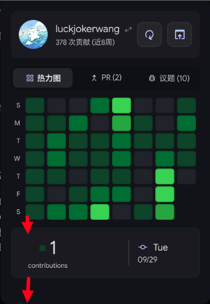

# 🐙 GitHub Hub

[](https://github.com/AvengeMedia/DankMaterialShell)
[](https://github.com/luckjokerwang/dms-githubhub)
[](https://github.com/luckjokerwang/dms-githubhub)

专为 **DankMaterialShell (DMS 2.0+)** 打造的个人 GitHub 综合效率中心与贡献监控微件。

---

## ✨ 特性亮点 (Features)

- **经典顶栏 7 天条形胶囊**：还原经典 8×16 垂直绿柱设计，极简纯粹。
- **28×28 正方形居中 8 周热力图**：8 周贡献方块水平绝对居中，两侧留白均匀对称。
- **颗粒悬浮数据提示**：鼠标划过网格方块，实时弹出微型浮动标签（如 `11/18: 1`），就地快看更直观。
- **Material 3 风格用户卡片**：展示 GitHub 真实头像与近 8 周累计贡献数，支持用户名与个人昵称随时切换。
- **活跃 PR / Issue 追踪**：仅聚焦当前处于 `open` 状态的活跃拉取请求与议题，剔除陈旧历史干扰。
- **浏览器一键速达**：卡片支持一键打开对应 PR/Issue 网页，随时跟进最新动态。
- **经典绿阶与随系统主题色变动**：默认采用 GitHub 标志性原生经典绿阶（自适应深浅色模式），亦可在设置中开启跟随 DMS 桌面主题强调色（Material You 强调色）。
- **弹窗快捷键与网络连通性验证**：支持弹窗内快捷键（`F5` / `Ctrl+R`）强制穿透防抖刷新，通过桌面通知即时反馈网络可用性与最新同步时间。
- **零配置优雅降级**：无需配置 API Key，未登录时展示通用热力图，接入 `gh` CLI 自动解锁完整功能。

---

## ⌨️ 快捷键与 IPC 联动 (Shortcuts & IPC)

### 1. IPC 接口清单

| 目标 (Target) | 方法 (Function) | 说明 |
| :--- | :--- | :--- |
| `githubHub` | `refresh` | 强制异步重新拉取热力图与 GitHub 数据（并弹出网络连通性 Toast） |
| `githubHub` | `toggle` | 呼出 / 收起 GitHub Hub 弹窗 |
| `githubHub` | `open` | 展开弹窗 |
| `githubHub` | `close` | 收起弹窗 |

### 2. 快捷键配置

- **弹窗内快捷键**：`F5` 或 `Ctrl + R` 刷新数据
- **手动 CLI 调用**：
  ```bash
  dms ipc call githubHub refresh
  ```

---

## 📸 界面预览 (Screenshots)

<div align="center">
  
</div>

---

## 📦 安装方式 (Installation)

### 方法 1：通过 DMS 插件广场安装 (推荐)

在终端运行以下命令：

```bash
dms plugins install githubHub
```

### 方法 2：手动从源码安装

克隆仓库至本地 DMS 插件目录：

```bash
cd ~/.config/DankMaterialShell/plugins
git clone https://github.com/luckjokerwang/dms-githubhub.git githubHub
```

重启 DMS 使其生效：

```bash
rm -rf ~/.cache/DankMaterialShell ~/.cache/quickshell && dms restart
```

---

## 🛠️ 系统依赖 (Requirements)

- `DankMaterialShell` >= 2.0.0
- `gh` (GitHub CLI, 可选，用于加载个人头像与 PR/Issue)
- `curl`, `jq`, `bash`

---

## 📄 开源许可 (License)

MIT License.
